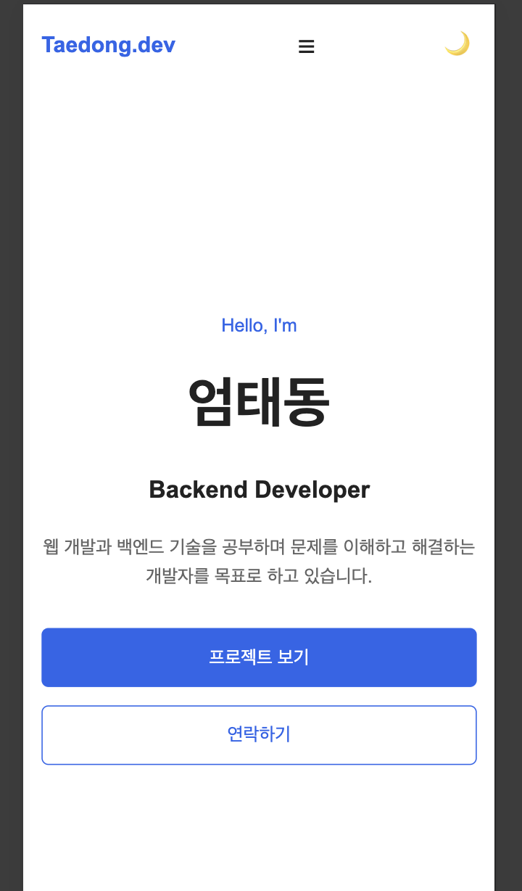
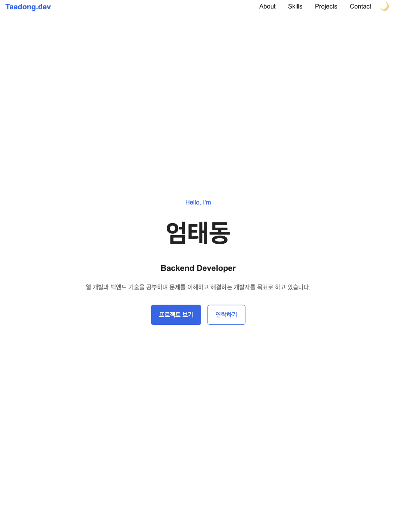
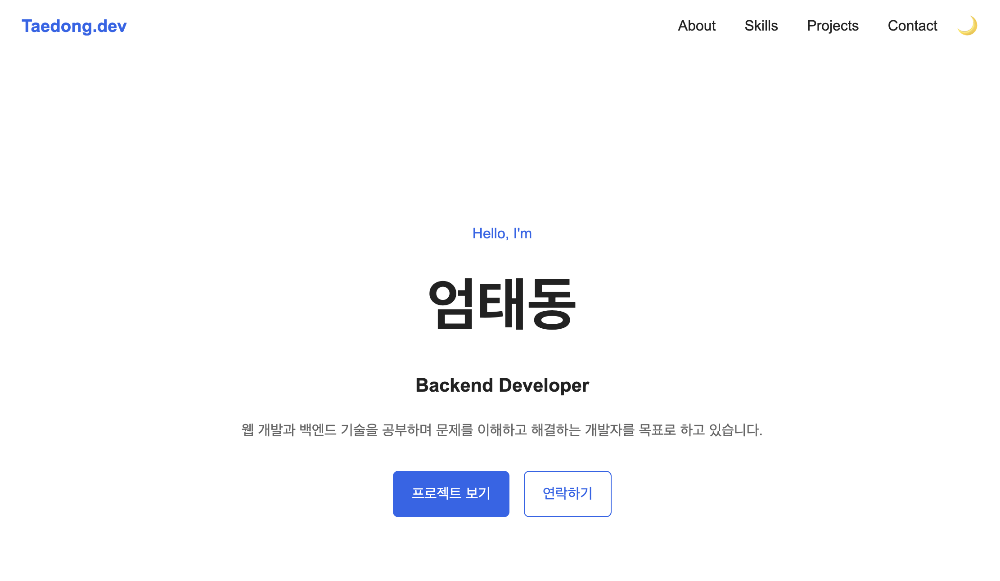
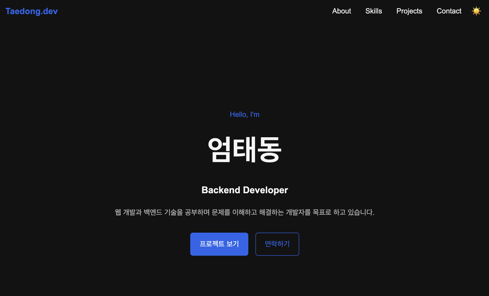

# 체크리스트 

- [ ] 프로젝트 기본 파일 구성 만들기
- [ ] HTML 전체 구조 작성하기
- [ ] CSS 기본 스타일 + 반응형 레이아웃 구현하기
- [ ] 햄버거 메뉴 / 스크롤 / 다크모드 기능 구현하기
- [ ] GitHub API 연동하고 선택한 프로젝트만 표시하기
- [ ] 로딩 / 에러 / 빈 상태 처리하기
- [ ] Contact 폼 유효성 검사 구현하기
- [ ] Intersection Observer 스크롤 애니메이션 구현하기
- [ ] 모바일 / 태블릿 / 데스크톱 화면 확인하기
- [ ] 다크모드와 새로고침 후 상태 유지 확인하기
- [ ] GitHub Pages로 배포하기
- [ ] 배포된 사이트에서 모든 기능 다시 테스트하기
- [ ] 데스크톱 / 모바일 / 다크모드 스크린샷 찍기
- [ ] README 작성 및 배포 URL 추가하기

# Vanilla JS Portfolio

순수 HTML, CSS, JavaScript로 구현한 반응형 개인 포트폴리오 웹사이트입니다.

React, Vue 등의 프레임워크 없이 DOM 조작, 이벤트 처리, 상태 변경, 비동기 API 호출을 직접 구현하는 것을 목표로 제작했습니다.

## 주요 기능

- 모바일 / 태블릿 / 데스크톱 반응형 레이아웃
- 모바일 햄버거 메뉴
- 부드러운 섹션 이동
- 스크롤 위치에 따른 Header 스타일 변경
- Scroll Top 버튼
- 다크 모드 전환 및 LocalStorage 상태 유지
- Intersection Observer 기반 스크롤 애니메이션
- GitHub API 기반 프로젝트 목록 렌더링
- 프로젝트 로딩 / 성공 / 에러 / 빈 상태 처리
- GitHub API 재시도 버튼 및 403 오류 처리
- Contact Form 필수값 및 이메일 형식 유효성 검사

## 기술 스택

- HTML5
- CSS3
- JavaScript (Vanilla JS)
- GitHub REST API
- LocalStorage
- Intersection Observer
- GitHub Pages

## 프로젝트 구조

```text
vanilla-js-portfolio/
├── index.html
├── README.md
├── css/
│   └── style.css
├── js/
│   └── main.js
└── images/
```

## 반응형 디자인

모바일 퍼스트 방식으로 작성했습니다.

- Mobile: 기본 스타일
- Tablet: 768px 이상
- Desktop: 1024px 이상

Navigation은 Flexbox를 사용하고 Projects 카드 영역은 CSS Grid의 `auto-fit`, `minmax()`를 사용해 화면 크기에 따라 자동으로 배치되도록 구현했습니다.

## 주요 인터랙션

### 햄버거 메뉴

모바일에서 햄버거 버튼을 클릭하면 `classList.toggle('active')`를 이용해 메뉴를 열고 닫습니다.

### 스크롤 기능

- Header 스타일 변경 기준: 60px
- Scroll Top 버튼 표시 기준: 300px
- Intersection Observer threshold: 0.2

Navigation 링크는 `scrollIntoView()`를 이용해 해당 Section으로 부드럽게 이동합니다.

### 다크 모드

사용자가 테마 버튼을 클릭하면 `data-theme` 값을 변경합니다.

선택된 테마는 LocalStorage에 저장하여 새로고침 후에도 유지됩니다.

## GitHub API

GitHub REST API를 `fetch`와 `async/await`로 호출하여 Repository 데이터를 가져옵니다.

```text
https://api.github.com/users/TaeDongUm/repos
```

포트폴리오에 표시할 Repository 이름만 설정값으로 관리하고, 실제 Repository의 설명, 언어, Star, URL 등은 GitHub API 응답 데이터를 사용합니다.

API 호출 과정에서 다음 상태를 UI로 구분해 처리합니다.

- Loading: 프로젝트를 불러오는 중
- Success: 프로젝트 카드 렌더링
- Empty: 표시할 프로젝트가 없는 경우
- Error: 프로젝트를 불러오지 못한 경우
- Retry: 다시 시도 버튼 제공
- 403: GitHub API 요청 제한 안내

## ES6+ 사용

- `const`
- 화살표 함수
- 템플릿 리터럴
- 구조분해 할당
- `map()`
- `filter()`
- `forEach()`
- `async/await`

## Contact Form

Contact Form은 다음 항목을 검증합니다.

- 이름 필수 입력
- 이메일 필수 입력
- 이메일 형식 검사
- 메시지 필수 입력

`input` 이벤트를 이용해 입력 중 상태를 갱신하고, `submit` 이벤트에서는 `event.preventDefault()`로 기본 제출 동작을 막은 뒤 전체 값을 다시 검증합니다.

현재 필수 과제 범위에서는 실제 이메일 전송 기능은 구현하지 않았습니다.

## 이벤트 → 상태 → 렌더링

이 프로젝트에서는 다음과 같은 흐름을 구현했습니다.

### Theme

```text
Theme 버튼 클릭
→ theme 변경
→ data-theme 변경
→ CSS 변수 변경
→ 화면 변경
```

### GitHub API

```text
API 호출
→ Loading 표시
→ API 응답
→ Success / Empty / Error
→ Projects 영역 업데이트
```

### Form

```text
사용자 입력
→ 유효성 검사
→ Form 상태 변경
→ 에러 메시지 표시/제거
```

### Hamburger Menu

```text
버튼 클릭
→ active 클래스 변경
→ Navigation 표시 상태 변경
```

## 실행 방법

저장소를 Clone합니다.

```bash
git clone https://github.com/TaeDongUm/vanilla-js-portfolio.git
cd vanilla-js-portfolio
```

VS Code에서 `index.html`을 Live Server로 실행합니다.

## 배포

GitHub Pages를 사용합니다.

배포 URL:

```text
https://taedongum.github.io/vanilla-js-portfolio/
```

GitHub Repository에서 다음과 같이 설정합니다.

```text
Settings
→ Pages
→ Build and deployment
→ Deploy from a branch
→ main
→ /root
```

## Screenshots

배포 후 다음 스크린샷을 추가하기

### Desktop

### Mobile



### Tablet



### Desktop



### Dark Mode



---

### 1. HTML에서 시맨틱 태그를 왜 사용했으며, 어떤 기준으로 구조를 설계했나요?

시맨틱 태그는 단순히 화면을 나누는 용도가 아니라, 각 영역이 어떤 의미와 역할을 가지는지 HTML 자체에서 표현하기 위해 사용했습니다.

페이지 상단 영역에는 `<header>`, 주요 메뉴에는 `<nav>`, 핵심 콘텐츠 영역에는 `<main>`, 각각의 콘텐츠 구역에는 `<section>`, 독립적인 콘텐츠에는 `<article>`, 페이지 하단에는 `<footer>`를 사용했습니다.

반면 `<div>`는 특별한 의미를 표현하기보다는 CSS를 통한 레이아웃 배치나 여러 요소를 하나의 그룹으로 묶어야 할 때 사용했습니다.

즉, 의미를 가지는 영역에는 시맨틱 태그를 사용하고, 단순한 배치나 그룹화가 필요한 경우에는 `<div>`를 사용하는 기준으로 구조를 설계했습니다.

### 2. CSS에서 Flexbox와 Grid의 차이는 무엇이며, 각각 언제 사용했나요?

Flexbox는 기본적으로 한 방향으로 요소를 정렬하거나 배치할 때 적합하고, Grid는 행과 열을 기준으로 여러 요소를 배치할 때 적합하다고 판단했습니다.

Navigation 영역에서는 로고와 메뉴를 하나의 행에 정렬해야 했기 때문에 Flexbox를 사용했습니다.

Projects 영역에서는 여러 프로젝트 카드를 화면 크기에 따라 자동으로 배치해야 했기 때문에 CSS Grid를 사용했습니다.

특히 Projects에서는 `auto-fit`과 `minmax()`를 사용하여 화면 너비에 따라 카드의 열 개수가 자동으로 변경되도록 구현했습니다.

### 3. `querySelector`로 DOM을 선택하고 `addEventListener`로 이벤트를 연결하는 흐름을 어떻게 구현했나요?

먼저 `querySelector` 또는 `querySelectorAll`을 사용하여 JavaScript에서 제어할 HTML 요소를 선택했습니다.

이후 선택한 요소에 `addEventListener`를 등록하여 사용자의 `click`, `scroll`, `input`, `submit` 등의 이벤트를 감지하도록 구현했습니다.

이벤트가 발생하면 상태나 DOM의 클래스, 속성, 텍스트 등을 변경하여 실제 화면이 변경되도록 구현했습니다.

즉, `DOM 요소 선택 → 이벤트 등록 → 사용자 행동 감지 → 상태 또는 DOM 변경 → 화면 업데이트`의 흐름으로 기능을 구성했습니다.

### 4. 화살표 함수, 구조분해 할당, 배열 메서드(`map`, `filter`, `forEach`)는 왜 사용했나요?

화살표 함수는 이벤트 콜백이나 작은 함수들을 간결하게 작성하기 위해 사용했습니다.

구조분해 할당은 GitHub API에서 전달받은 Repository 객체에서 `name`, `description`, `language`, `html_url` 등 필요한 값만 한 번에 추출하기 위해 사용했습니다.

`filter()`는 GitHub API를 통해 가져온 전체 Repository 중 포트폴리오에 표시할 프로젝트만 선택하기 위해 사용했습니다.

`map()`은 선택된 Repository 데이터를 프로젝트 카드 형태의 HTML 문자열로 변환하기 위해 사용했습니다.

`forEach()`는 여러 Navigation Link나 Intersection Observer 대상 요소를 순회하면서 각각 이벤트를 등록하거나 처리하기 위해 사용했습니다.

이를 통해 반복문을 직접 작성하는 것보다 코드의 목적을 명확하게 표현할 수 있었습니다.

### 5. `fetch`와 `async/await`로 비동기 데이터를 가져오고, 로딩/성공/실패 상태를 어떻게 표현했나요?

GitHub API는 네트워크를 통해 데이터를 받아와야 하기 때문에 비동기 처리가 필요했습니다.

`fetch()`를 사용하여 GitHub API에 Repository 데이터를 요청했고, 응답을 기다리기 위해 `async/await`를 사용했습니다.

API 요청 중에는 사용자가 현재 상태를 알 수 있도록 로딩 메시지를 표시했습니다.

요청에 성공하면 Repository 데이터를 프로젝트 카드 형태로 렌더링했고, 데이터가 없는 경우에는 빈 상태 메시지를 표시했습니다.

API 요청에 실패하거나 GitHub API 요청 제한이 발생한 경우에는 `try/catch`를 통해 오류를 처리하고, 에러 메시지와 다시 시도 버튼을 표시했습니다.

이를 통해 `Loading → Success / Empty / Error` 상태를 각각 구분하여 UI에 표현했습니다.

### 6. 하나의 기능을 만들기 위해 이벤트 → 상태 변경 → DOM 업데이트가 어떻게 연결되도록 구현했나요?

사용자의 이벤트가 발생하면 바로 화면만 변경하는 방식보다는, 먼저 애플리케이션의 상태를 변경한 후 해당 상태를 기준으로 화면을 다시 렌더링하는 구조를 사용했습니다.

예를 들어 다크모드 버튼을 클릭하면 현재 테마 상태를 변경하고, 변경된 상태를 LocalStorage에 저장한 뒤 렌더링 함수를 호출하여 `data-theme` 속성과 버튼 표시를 변경했습니다.

GitHub API에서도 API 요청이 시작되면 프로젝트 상태를 `loading`으로 변경하고, 요청이 성공하면 `success` 상태와 Repository 데이터를 저장했으며, 실패하면 `error` 상태와 오류 메시지를 저장한 뒤 해당 상태를 기준으로 Projects 영역을 다시 렌더링했습니다.

폼에서도 사용자의 입력 이벤트가 발생하면 입력값의 유효성 상태를 변경하고, 해당 상태에 따라 에러 메시지와 입력 필드의 스타일을 업데이트했습니다.

이처럼 `사용자 이벤트 → 상태 변경 → 렌더링 함수 호출 → DOM 업데이트 → 화면 변경`의 흐름을 기준으로 기능을 구현했습니다.

이 구조를 통해 React에서 사용하는 상태 기반 렌더링 방식의 기초 개념을 직접 경험할 수 있었습니다.

---

# 포트폴리오 미션 학습 및 발표 순서 정리(모든 내용보다는 필요한 부분만 뽑아서)

## 1. 프로젝트 소개 및 구조

HTML, CSS, JavaScript만 사용하여 반응형 포트폴리오를 구현했습니다.

주요 구성은 다음과 같습니다.

- Hero
- About
- Skills
- Projects
- Contact

주요 기능은 다음과 같습니다.

- 다크모드
- 모바일 햄버거 메뉴
- 부드러운 스크롤
- Scroll Top 버튼
- Intersection Observer 기반 스크롤 애니메이션
- GitHub API 기반 프로젝트 조회
- 프로젝트 언어 필터
- Contact Form 유효성 검사
- LocalStorage를 이용한 테마 유지

HTML에서는 각 영역의 의미에 따라 다음과 같은 시맨틱 태그를 사용했습니다.

```html
<header>
<nav>
<main>
<section>
<article>
<footer>
```

단순한 레이아웃 구성이나 요소 묶음에는 `<div>`를 사용했습니다.

프로젝트 파일은 역할별로 분리했습니다.

```text
index.html
css/
js/
images 또는 screenshots/
README.md
```

HTML은 페이지 구조, CSS는 디자인과 레이아웃, JavaScript는 사용자 동작과 상태 처리를 담당하도록 구성했습니다.

접근성을 위해 `alt`, `label`, `aria-label`, `aria-live` 등의 속성을 사용했습니다.

---

## 2. 반응형 웹과 모바일 퍼스트

기본 CSS를 모바일 화면 기준으로 작성하고, 화면 크기가 커질수록 `min-width` 미디어쿼리를 적용하는 모바일 퍼스트 방식으로 구현했습니다.

```css
@media (min-width: 768px) {
    ...
}

@media (min-width: 1024px) {
    ...
}
```

구조는 다음과 같습니다.

```text
기본 CSS
→ Mobile

768px 이상
→ Tablet

1024px 이상
→ Desktop
```

`@media`는 화면 크기 등의 조건에 따라 CSS를 적용하는 문법입니다.

JavaScript의 `if`문과 비슷한 역할을 합니다.

```css
@media (min-width: 768px) {
    .hero-actions {
        flex-direction: row;
    }
}
```

위 코드는 화면 너비가 768px 이상일 경우 `.hero-actions`의 `flex-direction`을 `row`로 적용합니다.

`@media`에서는 기존 속성을 덮어쓸 수도 있고, 기존에 없던 새로운 속성이나 선택자를 추가할 수도 있습니다.

---

## 3. Flexbox와 Grid

Flexbox는 주로 한 방향으로 요소를 정렬할 때 사용했습니다.

Navigation에서는 로고와 메뉴를 한 줄에 배치하기 위해 Flexbox를 사용했습니다.

```css
.navbar {
    display: flex;
    align-items: center;
    justify-content: space-between;
}
```

Grid는 여러 요소를 행과 열 형태로 배치할 때 사용했습니다.

Projects 카드 영역에서는 CSS Grid를 사용했습니다.

```css
.projects-grid {
    display: grid;

    grid-template-columns:
        repeat(
            auto-fit,
            minmax(250px, 1fr)
        );
}
```

`auto-fit`은 현재 화면에 들어갈 수 있는 만큼 열을 자동으로 배치합니다.

`minmax(250px, 1fr)`은 각 카드의 최소 너비를 250px로 유지하면서 남는 공간을 균등하게 사용할 수 있도록 합니다.

```text
Desktop
[카드][카드][카드]

Tablet
[카드][카드]

Mobile
[카드]
```

`display: flex`는 자식 요소에게 상속되지 않습니다.

```css
.parent {
    display: flex;
}
```

위 코드에서는 `.parent`가 Flex Container가 되고, 그 안의 자식 요소들이 Flex Item이 됩니다.

자식 요소 자체가 자동으로 `display: flex`가 되는 것은 아닙니다.

---

## 4. Hover 효과

버튼이나 카드 위에 마우스를 올렸을 때 요소가 살짝 위로 이동하도록 구현했습니다.

```css
.button:hover {
    transform: translateY(-2px);
}
```

`:hover`는 마우스가 해당 요소 위에 올라왔을 때 적용됩니다.

`translateY(-2px)`에서 음수는 Y축 기준 위쪽 이동을 의미합니다.

```text
Y축 음수
↑

요소

↓

Y축 양수
```

`transition`을 함께 사용하여 갑자기 움직이지 않고 부드럽게 이동하도록 했습니다.

Skills 카드에서도 같은 원리를 사용했습니다.

```css
.skill-card:hover {
    transform: translateY(-3px);
}
```

---

## 5. Projects 필터 버튼

Projects의 `전체`, `JavaScript`, `Python` 등의 버튼에는 `hover`와 `active` 상태를 적용했습니다.

```css
.filter-button:hover,
.filter-button.active {
    background-color: var(--primary-color);
    color: #ffffff;
}
```

`:hover`는 마우스를 올린 상태를 의미합니다.

`.active`는 실제로 선택된 버튼을 의미합니다.

JavaScript에서는 현재 선택된 언어와 버튼의 언어를 비교하여 `active` 클래스를 결정합니다.

```javascript
const activeClass =
    language === selectedLanguage
        ? 'active'
        : '';
```

```text
:hover
→ 마우스를 올린 동안 적용

.active
→ 실제 선택된 상태에 적용
```

---

## 6. DOM과 querySelector

브라우저는 HTML을 읽고 DOM(Document Object Model)을 생성합니다.

`querySelector()`는 HTML을 DOM으로 변환하는 기능이 아니라, 브라우저가 이미 생성한 DOM에서 원하는 Element 객체의 참조를 가져오는 기능입니다.

```javascript
const menuButton =
    document.querySelector('.menu-toggle');
```

위 코드를 통해 HTML의 `.menu-toggle` 요소를 JavaScript에서 사용할 수 있습니다.

DOM 객체에는 여러 프로퍼티와 메서드가 존재합니다.

예를 들어 Form 요소는 다음과 같은 기능을 사용할 수 있습니다.

```javascript
contactForm.reset();
```

또한 입력 요소에서는 다음과 같이 현재 값을 읽을 수 있습니다.

```javascript
nameInput.value
```

전체 흐름은 다음과 같습니다.

```text
HTML
→ 브라우저가 DOM 생성
→ querySelector()
→ DOM Element 참조
→ JavaScript에서 객체 조작
→ DOM 변경
→ 브라우저 화면 갱신
```

DOM이 변경되면 별도의 적용 버튼이나 저장 명령 없이 브라우저가 변경 사항을 화면에 반영합니다.

정확히는 JavaScript가 DOM을 변경하면 브라우저가 이후 렌더링 과정에서 스타일 계산과 화면 그리기를 수행합니다.

---

## 7. addEventListener

HTML 안에 `onclick` 같은 인라인 이벤트를 작성하지 않고 JavaScript에서 `addEventListener()`를 사용했습니다.

```javascript
menuButton.addEventListener(
    'click',
    () => {
        ...
    }
);
```

흐름은 다음과 같습니다.

```text
querySelector()
→ DOM 요소 선택

addEventListener()
→ 이벤트 등록

사용자 행동
→ 이벤트 발생

JavaScript 로직 실행
```

사용한 주요 이벤트는 다음과 같습니다.

```text
click
scroll
input
submit
```

---

## 8. Scroll에 따른 Navigation 변화

현재 스크롤 위치는 `window.scrollY`를 통해 확인합니다.

```javascript
const handleScroll = () => {

    const scrollPosition =
        window.scrollY;

};
```

`window.scrollY`는 페이지를 위에서부터 얼마나 아래로 이동했는지를 px 단위로 나타냅니다.

60px 이상 스크롤한 경우 Header에 `scrolled` 클래스를 추가했습니다.

```javascript
if (scrollPosition >= 60) {

    header.classList.add('scrolled');

} else {

    header.classList.remove('scrolled');
}
```

HTML 요소는 개념적으로 다음과 같이 변경됩니다.

```html
<header class="site-header">
```

에서

```html
<header class="site-header scrolled">
```

로 변경됩니다.

CSS에서는 해당 상태를 다음과 같이 처리합니다.

```css
.site-header.scrolled {
    box-shadow:
        0 2px 8px rgba(0, 0, 0, 0.1);
}
```

전체 흐름은 다음과 같습니다.

```text
사용자 스크롤
→ scroll 이벤트
→ window.scrollY
→ 60px 이상인지 확인
→ scrolled 클래스 추가
→ CSS 적용
→ Header 스타일 변경
```

---

## 9. Scroll Top 버튼

Scroll Top 버튼은 처음에는 숨겨진 상태입니다.

```css
.scroll-top-button {
    display: none;
}
```

`visible` 클래스가 추가되면 화면에 표시됩니다.

```css
.scroll-top-button.visible {
    display: block;
}
```

JavaScript에서는 300px을 기준으로 `visible` 클래스를 추가하거나 제거합니다.

```javascript
if (scrollPosition >= 300) {

    scrollTopButton.classList.add(
        'visible'
    );

} else {

    scrollTopButton.classList.remove(
        'visible'
    );
}
```

`scrollTopButton`은 새롭게 생성된 요소가 아니라 다음과 같이 기존 HTML 요소를 선택한 DOM 객체입니다.

```javascript
const scrollTopButton =
    document.querySelector(
        '#scroll-top-button'
    );
```

따라서:

```javascript
scrollTopButton.classList.add(
    'visible'
);
```

을 실행하면 실제 해당 HTML 요소의 class가 변경됩니다.

버튼을 클릭하면 다음 코드가 실행됩니다.

```javascript
scrollTopButton.addEventListener(
    'click',
    () => {

        window.scrollTo({
            top: 0,
            behavior: 'smooth'
        });

    }
);
```

`top: 0`은 페이지의 최상단을 의미하고, `behavior: 'smooth'`는 부드럽게 이동하도록 합니다.

---

## 10. z-index

`z-index`는 요소의 위치를 정렬하기 위한 속성이 아니라, 요소들이 겹쳤을 때 앞뒤 순서를 결정하기 위한 속성입니다.

```text
x축
→ 좌우

y축
→ 상하

z축
→ 앞뒤
```

이 프로젝트에서는 Header처럼 `position: fixed`를 사용하는 요소가 일반 콘텐츠 위에 표시될 수 있기 때문에 `z-index`를 사용했습니다.

```css
.site-header {
    position: fixed;
    z-index: 1000;
}
```

반응형 레이아웃과 `z-index`의 역할은 서로 다릅니다.

```text
반응형
→ 요소가 어디에 배치되는지 결정

z-index
→ 겹쳤을 때 어떤 요소가 앞에 보이는지 결정
```

---

## 11. STATE

애플리케이션의 현재 상태를 하나의 `STATE` 객체에서 관리했습니다.

```javascript
const STATE = {

    ui: {
        menuOpen: false,
        theme: 'light'
    },

    projects: {
        status: 'idle',
        data: [],
        error: null
    },

    form: {
        nameValid: false,
        emailValid: false,
        messageValid: false
    }
};
```

기존에는 다음과 같이 상태가 여러 전역 변수로 분리될 수 있었습니다.

```javascript
let loadedRepositories = [];

let selectedLanguage = '전체';
```

이를 `STATE`에 통합하면 현재 애플리케이션 상태를 한 곳에서 관리할 수 있습니다.

전체 흐름은 다음과 같습니다.

```text
사용자 이벤트
→ STATE 변경
→ render 함수 호출
→ DOM 변경
→ 화면 변경
```

순수 JavaScript에서는 `STATE` 값만 변경한다고 화면이 자동으로 변경되지는 않습니다.

```javascript
STATE.projects.status =
    'success';
```

위 코드만으로는 화면이 바뀌지 않습니다.

따라서 다음처럼 렌더링 함수도 실행해야 합니다.

```javascript
STATE.projects.status =
    'success';

renderProjects();
```

---

## 12. 다크모드

현재 테마를 `STATE.ui.theme`에서 관리했습니다.

사용자가 테마 버튼을 클릭하면 상태를 변경합니다.

```javascript
STATE.ui.theme =
    STATE.ui.theme === 'dark'
        ? 'light'
        : 'dark';
```

변경된 상태는 LocalStorage에 저장합니다.

```javascript
localStorage.setItem(
    'theme',
    STATE.ui.theme
);
```

그리고 렌더링 함수에서 HTML의 `data-theme` 속성을 변경합니다.

```javascript
document.documentElement.setAttribute(
    'data-theme',
    STATE.ui.theme
);
```

CSS에서는 다음과 같이 다크모드 전용 변수 값을 정의했습니다.

```css
[data-theme="dark"] {
    --bg-color: #121212;
    --text-color: #f5f5f5;
}
```

전체 흐름은 다음과 같습니다.

```text
Theme 버튼 클릭
→ STATE.ui.theme 변경
→ LocalStorage 저장
→ renderTheme()
→ data-theme 변경
→ CSS 변수 변경
→ 화면 변경
```

LocalStorage를 사용했기 때문에 새로고침 후에도 사용자가 선택한 테마를 다시 불러올 수 있습니다.

---

## 13. 새로고침

새로고침은 기존 페이지를 그대로 수정하는 것이 아니라 페이지를 다시 로드하는 과정입니다.

HTML을 다시 읽고 DOM을 새로 생성하며 JavaScript도 처음부터 다시 실행됩니다.

따라서 JavaScript의 일반 변수는 초기화됩니다.

```text
새로고침
→ HTML 다시 로드
→ DOM 다시 생성
→ JavaScript 다시 실행
→ 일반 변수 초기화
```

반면 LocalStorage에 저장된 값은 새로고침 이후에도 유지됩니다.

따라서 다크모드와 같은 사용자 설정을 유지하는 데 사용했습니다.

---

## 14. Contact Form 검증

### 이름 검증

사용자가 입력한 이름은 다음과 같이 가져옵니다.

```javascript
const value =
    nameInput.value.trim();
```

`nameInput.value`는 사용자가 입력한 값입니다.

`trim()`은 문자열 앞뒤의 공백을 제거합니다.

```text
"   엄태동   "
→ "엄태동"

"     "
→ ""
```

빈 값인 경우:

```javascript
if (value === '') {

    STATE.form.nameValid = false;

    nameError.textContent =
        '이름을 입력해주세요.';

    nameInput.classList.add(
        'invalid'
    );

    return false;
}
```

상태를 `false`로 변경하고, 에러 메시지를 표시하며, 입력창에 `invalid` 클래스를 추가합니다.

정상 값인 경우:

```javascript
STATE.form.nameValid = true;

nameError.textContent = '';

nameInput.classList.remove(
    'invalid'
);
```

에러 메시지를 제거하고 `invalid` 클래스를 제거합니다.

---

### 이메일 검증

이메일도 먼저 빈 값을 검사합니다.

추가로 정규식을 사용하여 기본적인 이메일 형식을 검사합니다.

```javascript
const emailPattern =
    /^[^\s@]+@[^\s@]+\.[^\s@]+$/;
```

개념적으로 다음 형태인지 확인합니다.

```text
문자들
@
문자들
.
문자들
```

예:

```text
abc
→ 실패

abc@test
→ 실패

abc@test.com
→ 통과
```

---

### 메시지 검증

메시지는 이름과 동일하게 `trim()`을 사용하여 빈 값을 검사합니다.

공백만 입력한 경우에도 빈 값으로 처리합니다.

---

## 15. 입력하는 순간 검증되는 이유

각 입력 필드에는 `input` 이벤트가 등록되어 있습니다.

```javascript
nameInput.addEventListener(
    'input',
    () => {

        validateName();

    }
);
```

`input` 이벤트는 사용자가 다음과 같은 행동을 할 때 발생합니다.

```text
글자 입력
삭제
붙여넣기
```

따라서 사용자가 값을 변경할 때마다 검증 함수가 다시 실행됩니다.

```text
input 이벤트
→ validateName()
→ 값 검사
→ STATE 변경
→ invalid 추가 또는 제거
→ 에러 메시지 변경
→ 화면 변경
```

DOM 변경 코드가 실행되면 브라우저가 해당 변경사항을 화면에 반영합니다.

별도의 비동기 저장 과정이나 적용 명령은 필요하지 않습니다.

---

## 16. Form Submit

Form Submit 이벤트에서는 기본 HTML Form 동작을 막았습니다.

```javascript
event.preventDefault();
```

HTML Form은 기본적으로 submit되면 데이터를 전송하고 페이지를 이동하거나 새로고침하려고 합니다.

`preventDefault()`를 사용하여 이 기본 동작을 막고 JavaScript에서 직접 유효성 검사를 수행하도록 했습니다.

```javascript
const nameValid =
    validateName();

const emailValid =
    validateEmail();

const messageValid =
    validateMessage();
```

하나라도 유효하지 않으면 제출을 중단합니다.

```javascript
if (
    !nameValid ||
    !emailValid ||
    !messageValid
) {

    return;
}
```

모든 값이 유효하면 다음 메서드를 이용해 입력값을 초기화합니다.

```javascript
contactForm.reset();
```

`reset()`은 HTML `<form>`에 포함된 입력 요소들의 값을 초기 상태로 되돌리는 Form 객체의 메서드입니다.

---

## 17. Intersection Observer

페이지가 처음 실행되면 각 Section에 `reveal` 클래스를 적용합니다.

```javascript
sections.forEach(
    (section) => {

        section.classList.add(
            'reveal'
        );

    }
);
```

CSS에서는 처음에 숨겨진 상태로 만듭니다.

```css
.reveal {
    opacity: 0;
    transform: translateY(20px);
}
```

Intersection Observer는 해당 Section이 브라우저의 viewport 안으로 들어오는 상황을 감지합니다.

```javascript
const observer =
    new IntersectionObserver(
        (entries) => {

            ...
        },
        {
            threshold: 0.2
        }
    );
```

`threshold: 0.2`는 관찰 대상 요소의 약 20%가 보이는 경계를 기준으로 callback이 실행되도록 설정한 것입니다.

callback 내부에서는:

```javascript
if (entry.isIntersecting) {

    entry.target
        .classList
        .add('visible');

}
```

를 사용합니다.

`entry.isIntersecting`은 현재 관찰 대상이 viewport와 겹치고 있는지를 나타냅니다.

`visible` 클래스가 추가되면:

```css
.reveal.visible {
    opacity: 1;
    transform: translateY(0);
}
```

스타일이 적용되어 요소가 부드럽게 나타납니다.

이후:

```javascript
observer.unobserve(
    entry.target
);
```

를 실행하여 해당 요소의 관찰을 중단합니다.

전체 흐름은 다음과 같습니다.

```text
페이지 실행
→ reveal 추가
→ 처음에는 숨김

Section이 viewport에 약 20% 진입
→ Observer callback
→ isIntersecting 확인
→ visible 추가
→ CSS transition
→ 화면에 표시
→ unobserve()
→ 이후 다시 관찰하지 않음
```

---

## 18. GitHub API

Projects 영역에서는 GitHub REST API를 사용하여 Repository 데이터를 가져옵니다.

```javascript
const response =
    await fetch(
        `https://api.github.com/users/${GITHUB_USERNAME}/repos?type=owner&per_page=100`
    );
```

응답 데이터를 JSON 형태로 변환합니다.

```javascript
const repositories =
    await response.json();
```

전체 흐름은 다음과 같습니다.

```text
fetch()
→ GitHub API 요청
→ await
→ 응답
→ response.json()
→ Repository 배열
```

---

## 19. async / await / try / catch

API 요청은 네트워크 응답을 기다려야 하므로 비동기 처리를 사용했습니다.

```javascript
const fetchRepositories =
    async () => {

        try {

            const response =
                await fetch(...);

        } catch (error) {

            ...
        }

    };
```

`async`는 비동기 작업을 수행하는 함수임을 나타냅니다.

`await`는 Promise 결과가 완료될 때까지 해당 비동기 작업의 결과를 기다리는 데 사용합니다.

`try/catch`는 정상 처리와 오류 처리를 분리하기 위해 사용했습니다.

```text
try
→ 정상 로직

catch
→ 오류 발생 시 처리
```

또한 `fetch()`는 HTTP 404, 403 등의 응답이 발생해도 항상 자동으로 `catch`에 들어가는 것은 아니기 때문에 `response.ok`를 확인했습니다.

```javascript
if (!response.ok) {
    throw new Error(...);
}
```

---

## 20. GitHub API 상태 UI

API 요청 상태를 다음과 같이 구분했습니다.

```text
Loading
Success
Empty
Error
```

Loading 상태에서는:

```text
프로젝트를 불러오는 중입니다...
```

같은 메시지를 표시합니다.

Success 상태에서는 프로젝트 카드를 출력합니다.

Empty 상태에서는:

```text
표시할 프로젝트가 없습니다.
```

같은 메시지를 표시합니다.

Error 상태에서는 오류 메시지와 다시 시도 버튼을 표시합니다.

비동기 작업은 즉시 완료되지 않고 실패할 가능성도 있기 때문에 현재 상태를 사용자에게 보여주도록 구성했습니다.

---

## 21. filter()

GitHub API에서 가져온 전체 Repository 중 포트폴리오에 표시할 Repository만 선택하기 위해 사용했습니다.

```javascript
const selectedRepositories =
    repositories.filter(
        (repository) =>
            SELECTED_PROJECTS.includes(
                repository.name
            )
    );
```

`filter()`는 조건을 만족하는 데이터만 남깁니다.

```text
전체 Repository
→ filter()
→ 선택한 Repository만 남김
```

---

## 22. map()

선택된 Repository 데이터를 프로젝트 카드 HTML로 변환하기 위해 사용했습니다.

```javascript
const projectCards =
    repositories.map(
        (repository) => {

            return `
                <article>
                    ${repository.name}
                </article>
            `;
        }
    );
```

`map()`은 배열의 각 데이터를 새로운 형태로 변환합니다.

```text
Repository 객체
→ map()
→ HTML 문자열
```

---

## 23. join()

`map()`의 결과는 배열입니다.

```javascript
[
    '<article>A</article>',
    '<article>B</article>'
]
```

이를 `innerHTML`에 넣기 위해 하나의 문자열로 합쳤습니다.

```javascript
projectsGrid.innerHTML =
    projectCards.join('');
```

결과:

```html
<article>A</article><article>B</article>
```

---

## 24. forEach()

여러 요소에 동일한 작업을 수행할 때 사용했습니다.

Navigation Link에 각각 이벤트를 등록하거나 여러 Section을 Intersection Observer에 등록할 때 사용했습니다.

```javascript
navLinks.forEach(
    (link) => {

        link.addEventListener(
            'click',
            ...
        );

    }
);
```

---

## 25. 구조분해 할당

GitHub API의 Repository 객체에서 필요한 값을 한 번에 가져오기 위해 사용했습니다.

```javascript
const {
    name,
    description,
    html_url,
    language,
    stargazers_count
} = repository;
```

다음과 같이 하나씩 가져오는 것보다 간결하게 작성할 수 있습니다.

```javascript
const name = repository.name;

const description =
    repository.description;
```

---

## 26. Template Literal

HTML 문자열 안에 JavaScript 값을 넣기 위해 Template Literal을 사용했습니다.

```javascript
return `
    <article>
        <h3>${name}</h3>
    </article>
`;
```

백틱을 사용하고 `${}` 안에 변수를 넣어 문자열 내부에 값을 삽입할 수 있습니다.

---

## 27. 전체 동작 구조

프로젝트의 주요 사용자 인터랙션은 다음 흐름으로 구성했습니다.

```text
사용자
↓
클릭 / 입력 / 스크롤
↓
Event
↓
JavaScript
↓
STATE 변경
↓
render 함수 또는 DOM 조작
↓
DOM 변경
↓
CSS 적용
↓
브라우저 화면 변경
```

GitHub API 데이터의 흐름은 다음과 같습니다.

```text
GitHub API
↓
fetch()
↓
async / await
↓
Repository 데이터
↓
filter()
↓
STATE.projects
↓
renderProjects()
↓
map()
↓
HTML 카드
↓
DOM
↓
화면
```

---

## 핵심 개념 요약

| 개념 | 역할 |
|---|---|
| HTML | 페이지의 구조와 의미 |
| CSS | 디자인과 레이아웃 |
| JavaScript | 사용자 동작과 로직 |
| DOM | HTML을 JavaScript에서 다룰 수 있는 객체 구조 |
| `querySelector()` | DOM에서 원하는 Element 참조 |
| `addEventListener()` | 사용자 이벤트 감지 |
| STATE | 애플리케이션의 현재 상태 |
| render 함수 | 상태를 DOM에 반영 |
| `@media` | 조건에 따른 CSS 적용 |
| Flexbox | 한 방향 요소 정렬 |
| Grid | 행과 열 형태의 레이아웃 |
| `z-index` | 겹친 요소의 앞뒤 순서 |
| LocalStorage | 새로고침 후에도 데이터 유지 |
| Intersection Observer | 요소의 viewport 진입 감지 |
| `fetch()` | 외부 API 요청 |
| `async/await` | 비동기 처리 |
| `try/catch` | 오류 처리 |
| `filter()` | 조건에 맞는 데이터 선택 |
| `map()` | 데이터를 새로운 형태로 변환 |
| `forEach()` | 배열의 각 요소에 작업 수행 |
| `preventDefault()` | HTML 기본 이벤트 동작 방지 |
| `trim()` | 문자열 앞뒤 공백 제거 |